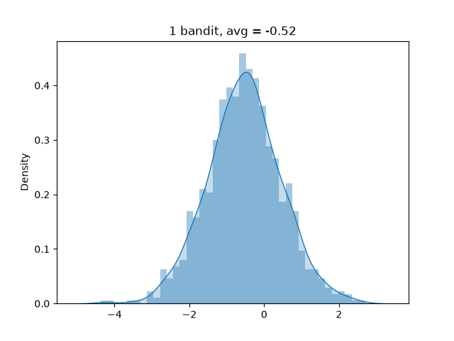
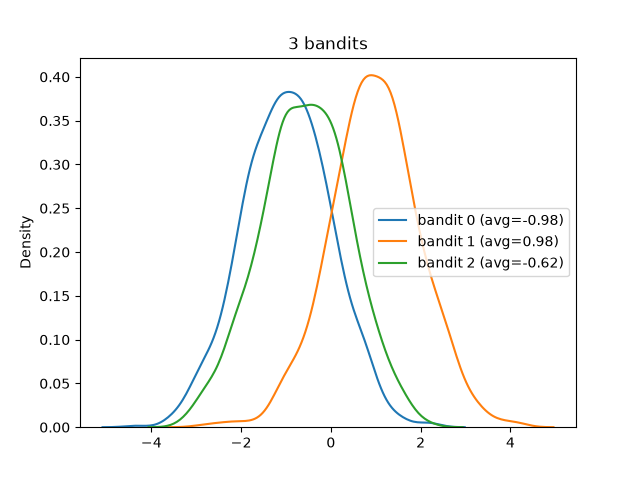
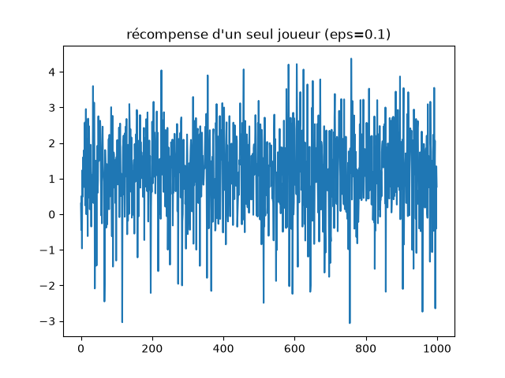
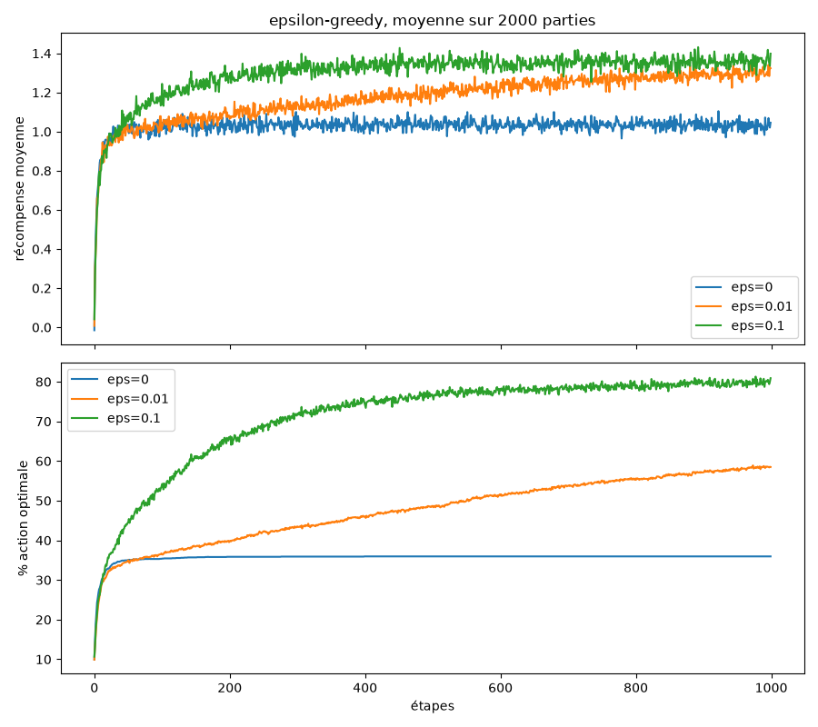
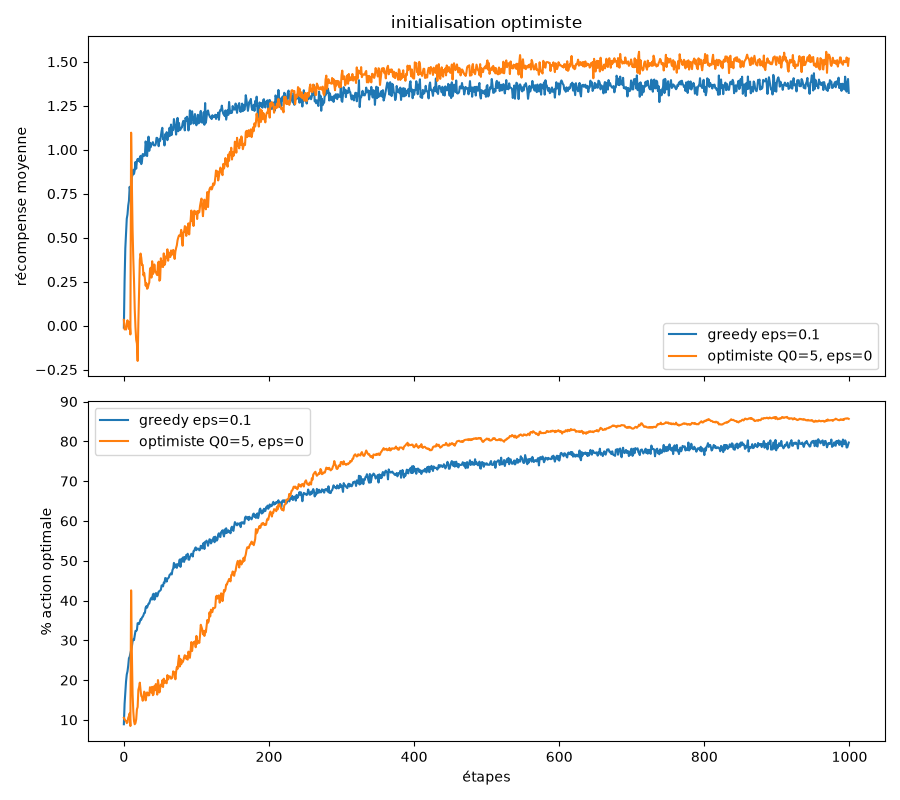
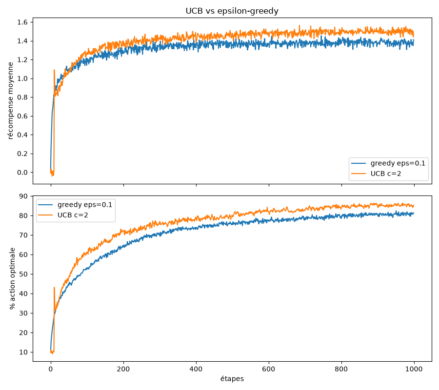
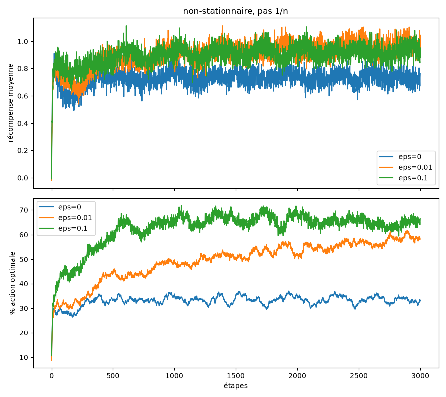
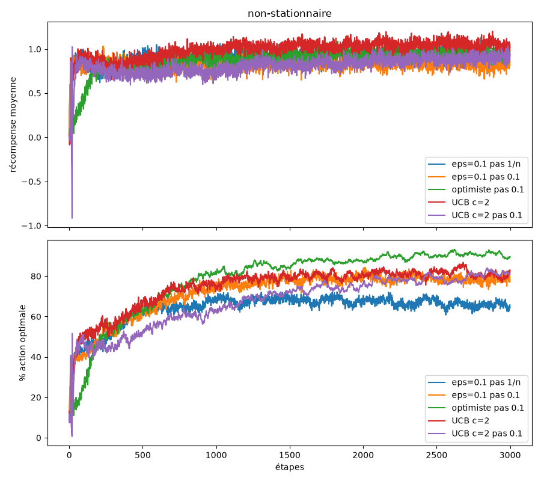

# TP bandit à N bras - Rapport

Groupe : Ahmed Adel BEREKSI REGUIG, Ismail ELBOUCH, Anis GRIGAH

## Répartition du travail

| Membre | Travail réalisé |
|---|---|
| Ahmed Adel BEREKSI REGUIG | Exercice 1 (classe Bandit, histogrammes et KDE), exercice 2 (classe Ban10), exercice 6 (UCBGreedyPlayer, comparaison avec epsilon-greedy et interprétation) |
| Ismail ELBOUCH | Exercice 3 (GreedyPlayer epsilon-greedy, questions 1 à 11), exercice 4 (simulation sur 2000 parties, graphiques pour epsilon = 0, 0.01 et 0.1 et interprétation) |
| Anis GRIGAH | Exercice 5 (OptimistGreedyPlayer, comparaison et interprétation), exercice 7 bonus (MovingBandit, MovingBan10, tests et graphiques non-stationnaires) |

Chacun a écrit le code, fait les tests et les graphiques et rédigé dans ce rapport les réponses des questions qui lui étaient attribuées. Le rapport complet a ensuite été relu et corrigé par les trois membres du groupe.

## Reproduction des résultats

Le code est en Python 3. Il y a deux fichiers : bandit.py contient les classes, main.py contient une fonction par exercice.

- Installer les dépendances : pip install -r requirements.txt (matplotlib et seaborn)
- Tout lancer : python main.py
- Lancer seulement certains exercices : python main.py 1 4 6 (numéros possibles : 1, 3, 4, 5, 6, 7)

Les graphiques sont enregistrés en PNG dans le dossier courant. Toutes les simulations de moyenne sont faites sur 2000 parties de 1000 coups (500 parties de 3000 coups pour l'exercice 7). Tout tourne en moins d'une minute. Les valeurs sont aléatoires (pas de graine fixée), les courbes changent donc un peu d'un lancement à l'autre mais l'allure reste la même.


Code (main.py) :

```python
import sys
import random

import matplotlib.pyplot as plt
import seaborn as sns

from bandit import (Bandit, Ban10, MovingBan10, GreedyPlayer,
                    OptimistGreedyPlayer, UCBGreedyPlayer)

STEPS = 1000
RUNS = 2000


if __name__ == "__main__":
    exos = {"1": ex1, "3": ex3, "4": ex4, "5": ex5, "6": ex6, "7": ex7}
    todo = sys.argv[1:] or ["1", "3", "4", "5", "6", "7"]
    for e in todo:
        print("=== exercice", e)
        exos[e]()
```

## Exercice 1 - Le bandit manchot

1. La classe Bandit tire avg avec random.gauss(0, 1) dans le constructeur.
2. La méthode play renvoie random.gauss(self.avg, 1).
3. On joue 1000 fois et on trace un histogramme avec une KDE par dessus. On obtient bien une courbe en cloche centrée sur avg.



4. Avec 3 bandits on obtient 3 cloches de même largeur mais avec des pics à 3 positions différentes, qui correspondent aux 3 valeurs de avg.




Code (bandit.py) :

```python
class Bandit:
    def __init__(self):
        self.avg = random.gauss(0, 1)

    def play(self):
        return random.gauss(self.avg, 1)
```

Code (main.py) :

```python
def ex1():
    b = Bandit()
    vals = [b.play() for _ in range(1000)]
    plt.figure()
    sns.kdeplot(vals, fill=True)
    plt.hist(vals, bins=40, density=True, alpha=0.4)
    plt.title(f"1 bandit, avg = {b.avg:.2f}")
    plt.savefig("ex1_un_bandit.png")
    plt.close()

    plt.figure()
    for i in range(3):
        b = Bandit()
        vals = [b.play() for _ in range(1000)]
        sns.kdeplot(vals, label=f"bandit {i} (avg={b.avg:.2f})")
    plt.legend()
    plt.title("3 bandits")
    plt.savefig("ex1_trois_bandits.png")
    plt.close()
```

## Exercice 2 - Le ban-10

1. Ban10 crée 10 Bandit dans une liste self.bandits.
2. L'attribut self.best contient l'indice du bandit qui a le plus grand avg (calculé dans _find_best en parcourant la liste).
3. play(arm) appelle play sur le bandit numéro arm et renvoie la récompense.


Code (bandit.py) :

```python
class Ban10:
    bandit_class = Bandit

    def __init__(self):
        self.bandits = [self.bandit_class() for _ in range(10)]
        self.best = self._find_best()

    def _find_best(self):
        best = 0
        for i in range(len(self.bandits)):
            if self.bandits[i].avg > self.bandits[best].avg:
                best = i
        return best

    def play(self, arm):
        r = self.bandits[arm].play()
        return r
```

## Exercice 3 - Algorithme epsilon-greedy

1. GreedyPlayer(n, eps) stocke n et eps.
2. Q et N s'appellent action_values et eval_count, ce sont des listes de n zéros.
3. get_action ne prend pas de paramètre et renvoie le numéro du bras.
4. On tire random.random() et explore vaut True si la valeur est inférieure à eps.
5. _greedy_action prend le max de action_values et choisit au hasard parmi toutes les actions qui ont cette valeur (donc au début, comme tout est à 0, c'est complètement aléatoire).
6. _random_action renvoie random.randrange(n).
7. get_action appelle _random_action si explore, _greedy_action sinon.
8. reward(action, r) incrémente N(a) puis met à jour Q avec la formule incrémentale du cours : Q(a) = Q(a) + 1/N(a) * (r - Q(a)). On a ajouté un paramètre optionnel step : s'il est donné on utilise un pas constant à la place de 1/N (utile pour l'exercice 7).
9. et 10. C'est la fonction ex3 de main.py : get_action, puis play sur le Ban10, puis reward, dans une boucle de 1000 itérations.
11. python main.py 3 affiche pour chaque itération le numéro, la récompense et "optimal" ou "pas optimal". Au début les choix sont rarement optimaux et à la fin on voit surtout "optimal" (sauf pour les 10% de coups d'exploration).


Code (bandit.py) :

```python
class GreedyPlayer:
    def __init__(self, n, eps, step=None):
        self.n = n
        self.eps = eps
        self.step = step
        self.action_values = [0.0] * n
        self.eval_count = [0] * n
        self.t = 0

    def get_action(self):
        explore = random.random() < self.eps
        if explore:
            return self._random_action()
        return self._greedy_action()

    def _greedy_action(self):
        m = max(self.action_values)
        best = [a for a in range(self.n) if self.action_values[a] == m]
        return random.choice(best)

    def _random_action(self):
        return random.randrange(self.n)

    def reward(self, action, r):
        self.t += 1
        self.eval_count[action] += 1
        if self.step is None:
            alpha = 1 / self.eval_count[action]
        else:
            alpha = self.step
        self.action_values[action] += alpha * (r - self.action_values[action])
```

Code (main.py) :

```python
def ex3(verbose=True):
    ban = Ban10()
    p = GreedyPlayer(10, 0.1)
    rewards = []
    for i in range(STEPS):
        a = p.get_action()
        r = ban.play(a)
        p.reward(a, r)
        rewards.append(r)
        if verbose:
            print(i, round(r, 3), "optimal" if a == ban.best else "pas optimal")
    return rewards
```

## Exercice 4 - Graphiques simples

1. La récompense d'un seul joueur sur 1000 coups est très bruitée car chaque récompense a une variance de 1. On voit à peine la tendance.



2. La fonction simulate crée 2000 Ban10 et 2000 joueurs et les fait jouer coup par coup (les 2000 jouent le coup 1, puis le coup 2, etc.).
3. et 4. On trace la récompense moyenne des 2000 joueurs et le pourcentage de joueurs qui ont choisi le bras optimal à chaque étape.
5. Résultats pour epsilon = 0, 0.01 et 0.1 :



6. Interprétation. Au début les trois courbes montent de la même façon, eps=0 est même légèrement meilleur sur les tout premiers coups car il ne gaspille pas de coups en exploration. Mais le joueur purement greedy se bloque très vite sur le premier bras qui lui a donné une bonne récompense, qui n'est souvent pas le meilleur. Il plafonne vers 1.0 de récompense et environ 35% de choix optimaux, et ça ne bouge plus jamais.
Avec eps=0.1 le joueur explore beaucoup, trouve le meilleur bras plus rapidement et arrive à environ 1.35 de récompense et 80% de choix optimaux au bout de 1000 coups. Il ne peut pas dépasser environ 91% (90% de coups greedy plus 1 chance sur 10 de tomber sur le bon bras en explorant).
Avec eps=0.01 l'apprentissage est beaucoup plus lent (environ 58% à 1000 coups) mais la courbe continue de monter. Asymptotiquement il devrait dépasser eps=0.1 puisqu'il peut monter jusqu'à environ 99% d'optimalité.


Code (main.py) :

```python
def simulate(make_player, make_ban=Ban10, bans=None, steps=STEPS, runs=RUNS):
    if bans is None:
        bans = [make_ban() for _ in range(runs)]
    players = [make_player() for _ in range(len(bans))]
    mean_rewards = []
    optimal = []
    for t in range(steps):
        total = 0
        good = 0
        for p, ban in zip(players, bans):
            a = p.get_action()
            r = ban.play(a)
            p.reward(a, r)
            total += r
            if a == ban.best:
                good += 1
        mean_rewards.append(total / len(bans))
        optimal.append(100 * good / len(bans))
    return mean_rewards, optimal


def plot_results(results, name, title=""):
    fig, (ax1, ax2) = plt.subplots(2, 1, figsize=(9, 8), sharex=True)
    for label, (rew, opt) in results.items():
        ax1.plot(rew, label=label)
        ax2.plot(opt, label=label)
    ax1.set_ylabel("récompense moyenne")
    ax2.set_ylabel("% action optimale")
    ax2.set_xlabel("étapes")
    ax1.legend()
    ax2.legend()
    if title:
        ax1.set_title(title)
    plt.tight_layout()
    plt.savefig(name)
    plt.close()


def ex4():
    rewards = ex3(verbose=False)
    plt.figure()
    plt.plot(rewards)
    plt.title("récompense d'un seul joueur (eps=0.1)")
    plt.savefig("ex4_un_joueur.png")
    plt.close()

    res = {}
    for eps in [0, 0.01, 0.1]:
        print("eps =", eps)
        res[f"eps={eps}"] = simulate(lambda: GreedyPlayer(10, eps))
    plot_results(res, "ex4_epsilons.png", "epsilon-greedy, moyenne sur 2000 parties")
```

## Exercice 5 - Initialisation optimiste

1. OptimistGreedyPlayer hérite de GreedyPlayer.
2. Son constructeur met action_values à 5 pour tous les bras. Par défaut eps=0 et on utilise un pas constant de 0.1 comme dans le cours (avec un pas 1/N la valeur initiale serait écrasée dès le premier essai).
3. On compare avec GreedyPlayer eps=0.1 en utilisant exactement la même liste de Ban10 pour les deux joueurs.



4. Interprétation. Au début l'optimiste est nettement moins bon. Comme toutes les valeurs valent 5, chaque bras essayé déçoit et sa valeur baisse, donc le joueur passe à un autre bras : c'est une exploration forcée même avec eps=0. On voit un pic vers l'étape 10, quand tous les bras ont été essayés une fois et que le joueur choisit le meilleur, puis ça redescend parce que la valeur de ce bras baisse à son tour en dessous de celles des autres bras encore surestimés.
Après environ 250 coups les estimations sont proches des vraies valeurs, le joueur n'explore plus et il dépasse eps-greedy : environ 86% de choix optimaux contre 80%, et une meilleure récompense moyenne. Par contre cette méthode n'explore qu'au début, elle ne marcherait pas si le problème change au cours du temps.


Code (bandit.py) :

```python
class OptimistGreedyPlayer(GreedyPlayer):
    def __init__(self, n, eps=0, q0=5, step=0.1):
        super().__init__(n, eps, step)
        self.action_values = [float(q0)] * n
```

Code (main.py) :

```python
def ex5():
    bans = [Ban10() for _ in range(RUNS)]
    res = {}
    res["greedy eps=0.1"] = simulate(lambda: GreedyPlayer(10, 0.1), bans=bans)
    res["optimiste Q0=5, eps=0"] = simulate(lambda: OptimistGreedyPlayer(10), bans=bans)
    plot_results(res, "ex5_optimiste.png", "initialisation optimiste")
```

## Exercice 6 - Sélection Upper-Confidence-Bound

1. UCBGreedyPlayer hérite de GreedyPlayer et prend en plus le paramètre c.
2. _greedy_action est surchargée avec la formule du cours : A = argmax( Q(a) + c * racine(ln(t) / N(a)) ). t est le nombre d'appels à reward. Un bras avec N(a) = 0 est considéré comme maximal, donc on essaye d'abord chaque bras une fois.
3. Comparaison avec eps=0.1, pour c=2 :



4. Interprétation. Les 10 premiers coups UCB essaye chaque bras une fois, d'où le pic à l'étape 11 (il choisit alors le bras qui a donné la meilleure récompense). Ensuite UCB est meilleur que eps-greedy pendant tout le reste : il explore en priorité les bras dont l'estimation est incertaine (peu joués) au lieu d'explorer au hasard des bras déjà connus comme mauvais. Asymptotiquement il arrive à environ 85% de choix optimaux et 1.5 de récompense contre 80% et 1.35 pour eps=0.1. Le bonus d'exploration diminue avec N(a) mais ne disparaît jamais complètement (ln t augmente), donc il continue d'explorer un peu.


Code (bandit.py) :

```python
class UCBGreedyPlayer(GreedyPlayer):
    def __init__(self, n, c, eps=0, step=None):
        super().__init__(n, eps, step)
        self.c = c

    def _greedy_action(self):
        untried = [a for a in range(self.n) if self.eval_count[a] == 0]
        if untried:
            return random.choice(untried)
        lt = math.log(self.t)
        scores = [self.action_values[a] + self.c * math.sqrt(lt / self.eval_count[a]) for a in range(self.n)]
        m = max(scores)
        best = [a for a in range(self.n) if scores[a] == m]
        return random.choice(best)
```

Code (main.py) :

```python
def ex6():
    bans = [Ban10() for _ in range(RUNS)]
    res = {}
    res["greedy eps=0.1"] = simulate(lambda: GreedyPlayer(10, 0.1), bans=bans)
    res["UCB c=2"] = simulate(lambda: UCBGreedyPlayer(10, 2), bans=bans)
    plot_results(res, "ex6_ucb.png", "UCB vs epsilon-greedy")
```

## Exercice 7 (bonus) - Problèmes non-stationnaires

1. MovingBandit hérite de Bandit. La moyenne suit un sinus : avg = milieu + amplitude * sin(2 pi t / période + phase). La période est tirée entre 100 et 500 coups, le min et le max sont tirés avec une gaussienne et la phase est aléatoire. t augmente à chaque appel de play, donc avg change à chaque coup.
2. MovingBan10 hérite de Ban10 et crée des MovingBandit. Comme le meilleur bras change, best est recalculé avant chaque coup.
3. Différentes valeurs d'epsilon (pas 1/N) :



4. Comparaison avec l'initialisation optimiste et UCB, avec un pas 1/N ou un pas constant de 0.1 :



Avec un pas 1/N toutes les récompenses passées ont le même poids, donc après un certain temps l'estimation ne suit plus les changements du bandit : eps=0.1 avec pas 1/N plafonne vers 65% et a tendance à baisser. Avec un pas constant les récompenses récentes comptent plus et l'estimation suit le sinus, on reste vers 80%. Sans exploration (eps=0) c'est le pire (environ 33% de choix optimaux), le joueur ne voit jamais qu'un autre bras est devenu meilleur. eps=0.01 monte lentement jusqu'à environ 58%. L'initialisation optimiste avec pas constant s'en sort bien ici (environ 90%), sans doute parce que les sinus sont lents et qu'avec un pas de 0.1 un bras qui baisse est vite abandonné au profit des autres. UCB marche bien aussi parce que son bonus pousse quand même à revisiter les bras peu joués.


Code (bandit.py) :

```python
class MovingBandit(Bandit):
    def __init__(self):
        super().__init__()
        self.period = random.randint(100, 500)
        a = random.gauss(0, 1)
        b = random.gauss(0, 1)
        self.low = min(a, b)
        self.high = max(a, b)
        self.phase = random.uniform(0, 2 * math.pi)
        self.t = 0
        self._update_avg()

    def _update_avg(self):
        mid = (self.low + self.high) / 2
        amp = (self.high - self.low) / 2
        self.avg = mid + amp * math.sin(2 * math.pi * self.t / self.period + self.phase)

    def play(self):
        r = random.gauss(self.avg, 1)
        self.t += 1
        self._update_avg()
        return r


class MovingBan10(Ban10):
    bandit_class = MovingBandit

    def play(self, arm):
        self.best = self._find_best()
        r = self.bandits[arm].play()
        return r
```

Code (main.py) :

```python
def ex7():
    steps = 3000
    res = {}
    for eps in [0, 0.01, 0.1]:
        print("moving eps =", eps)
        res[f"eps={eps}"] = simulate(lambda: GreedyPlayer(10, eps), make_ban=MovingBan10, steps=steps, runs=500)
    plot_results(res, "ex7_moving_eps.png", "non-stationnaire, pas 1/n")

    res = {}
    res["eps=0.1 pas 1/n"] = simulate(lambda: GreedyPlayer(10, 0.1), make_ban=MovingBan10, steps=steps, runs=500)
    res["eps=0.1 pas 0.1"] = simulate(lambda: GreedyPlayer(10, 0.1, step=0.1), make_ban=MovingBan10, steps=steps, runs=500)
    res["optimiste pas 0.1"] = simulate(lambda: OptimistGreedyPlayer(10), make_ban=MovingBan10, steps=steps, runs=500)
    res["UCB c=2"] = simulate(lambda: UCBGreedyPlayer(10, 2), make_ban=MovingBan10, steps=steps, runs=500)
    res["UCB c=2 pas 0.1"] = simulate(lambda: UCBGreedyPlayer(10, 2, step=0.1), make_ban=MovingBan10, steps=steps, runs=500)
    plot_results(res, "ex7_moving_compare.png", "non-stationnaire")
```
