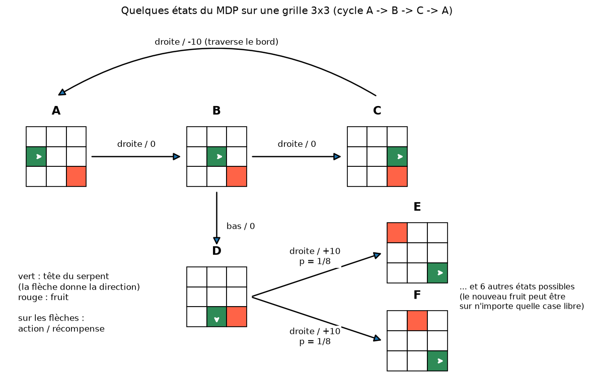
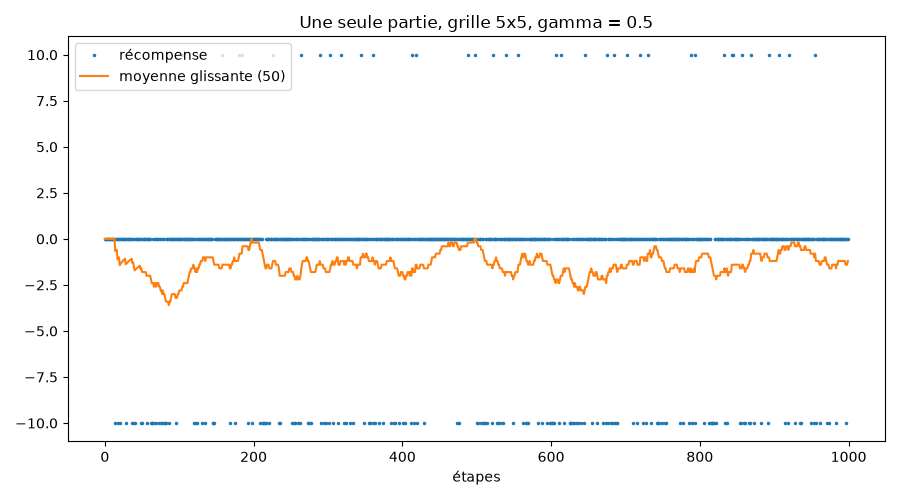
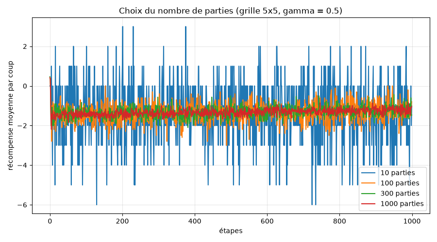
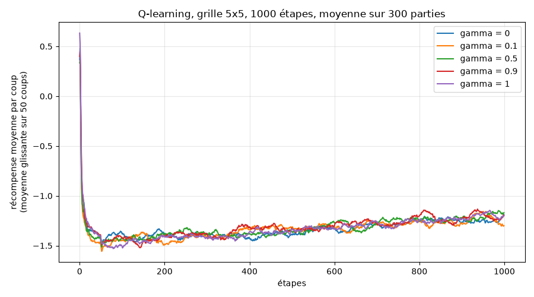
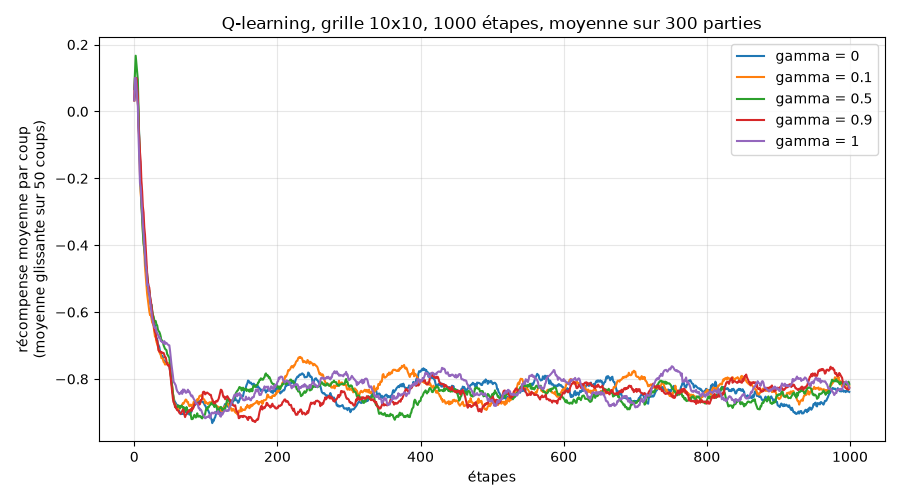
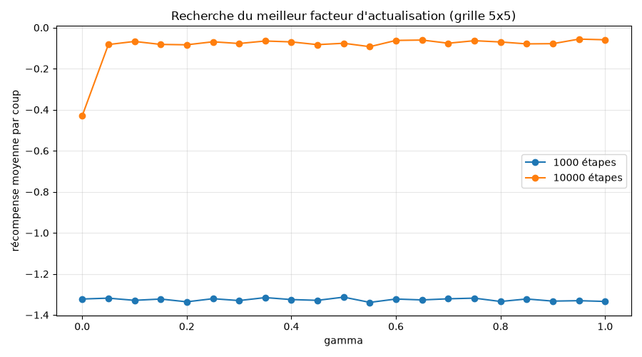
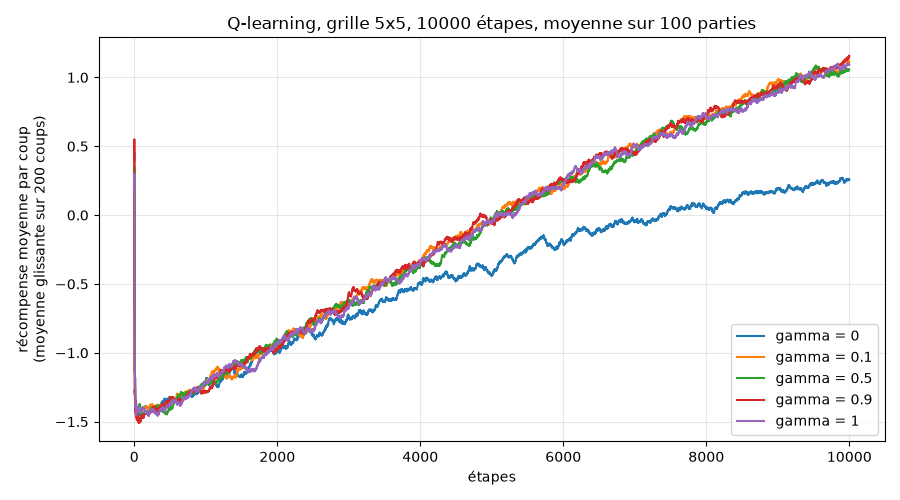
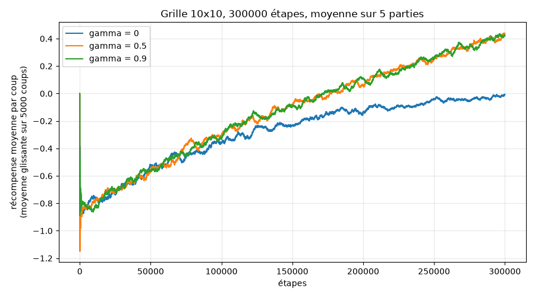
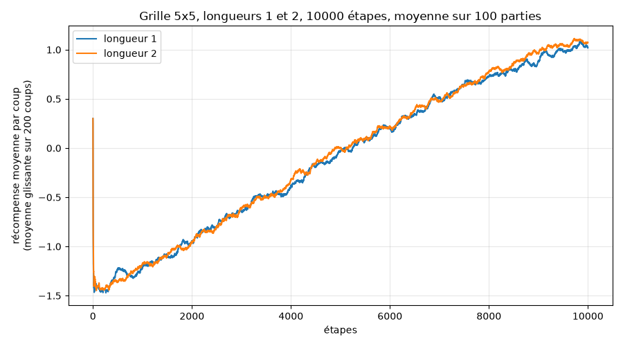
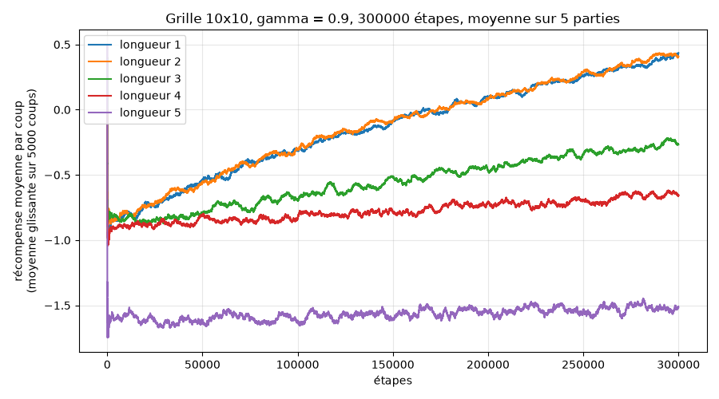

# TP MDP : Snake - Rapport

Groupe : Ahmed Adel BEREKSI REGUIG, Ismail ELBOUCH, Anis GRIGAH

## Répartition du travail

| Membre | Travail réalisé |
|---|---|
| Ahmed Adel BEREKSI REGUIG | Exercice 1 (classe ShortSnake, questions 1 à 8), exercice 3 questions 1 et 2 (save_state, restore_state), exercice 4 bonus (serpents plus longs, questions 1 à 7) |
| Ismail ELBOUCH | Exercice 2 (modélisation du MDP, questions 1 à 7 et schéma), exercice 3 questions 3 à 9 (formule et implémentation du Q-learning dans GreedyPlayer, programme principal) |
| Anis GRIGAH | Exercice 3 questions 10 à 14 (graphiques, choix du nombre de parties et de la taille de grille, comparaison et recherche du meilleur gamma sur 1000, 10000 et 300000 étapes) |

Chacun a écrit le code, fait les tests et les graphiques et rédigé dans ce rapport les réponses des questions qui lui étaient attribuées. Le rapport complet a ensuite été relu et corrigé par les trois membres du groupe.

## Reproduction des résultats

Le code est en Python 3, la seule dépendance est matplotlib (pip install -r requirements.txt).

- snake.py : la classe ShortSnake (le jeu)
- agent.py : la classe GreedyPlayer (Q-learning epsilon-greedy)
- main.py : une fonction par exercice, les graphiques sont enregistrés en PNG

Commandes :

- python main.py : lance tout (environ 3 minutes)
- python main.py 1 : démonstration du jeu dans le terminal
- python main.py 2 : schéma du MDP (ex2_mdp.png)
- python main.py 3 : questions 10 à 12 de l'exercice 3
- python main.py recherche : recherche du meilleur gamma (questions 13 et 14)
- python main.py long : entraînements de 10000 et 300000 étapes (question 14)
- python main.py 4 : serpents plus longs (bonus)

Paramètres utilisés partout sauf indication contraire : epsilon = 0.1, alpha = 0.1, Q initialisé à 0. Il n'y a pas de graine aléatoire fixée, les chiffres peuvent donc varier un peu d'un lancement à l'autre.


Code (main.py) :

```python
import sys
import time

import matplotlib.pyplot as plt
from matplotlib.patches import FancyArrowPatch, Rectangle

from snake import ShortSnake, UP, DOWN, LEFT, RIGHT, NAMES
from agent import GreedyPlayer

SIZE = 5
BIG = 10
STEPS = 1000
RUNS = 300
GAMMAS = [0, 0.1, 0.5, 0.9, 1]


if __name__ == "__main__":
    exos = {"1": ex1, "2": ex2, "3": ex3, "recherche": ex3_search, "long": ex3_long, "4": ex4}
    todo = sys.argv[1:] or ["1", "2", "3", "recherche", "long", "4"]
    for e in todo:
        print("=== exercice", e)
        exos[e]()
```

## Exercice 1 - Jeu de base

1. ShortSnake(width, height=None, length=1) crée une grille width x height (une liste de listes). Si height n'est pas donné la grille est carrée.
2. snake_pos est la position de la tête (x, y) et snake_dir la direction, un vecteur (dx, dy). Au départ le serpent est au milieu de la grille et va vers la droite. En interne on garde la liste body des cases du serpent (une seule case ici, utile pour le bonus) et snake_pos renvoie body[0].
3. fruit_pos est tiré au hasard parmi les cases qui ne sont pas occupées par le serpent.
4. score vaut 0 au départ.
5. move(direction) change la direction puis avance la tête d'une case. Avec None on continue tout droit. Si on demande la direction opposée au mouvement actuel, elle est ignorée et le serpent continue tout droit. La méthode renvoie la récompense obtenue pendant ce coup (pratique pour le Q-learning).
6. Si la tête sort de la grille, elle réapparaît de l'autre côté (modulo la taille) et le score perd 10 points.
7. Si la tête arrive sur le fruit, le score gagne 10 points et un nouveau fruit est placé au hasard sur une case libre.
8. __str__ affiche la grille (@ pour la tête, o pour le corps, * pour le fruit, . pour une case vide) puis le score. python main.py 1 montre quelques coups, par exemple le passage d'un bord qui donne -10.

Code (snake.py) :

```python
import random

UP = (0, -1)
DOWN = (0, 1)
LEFT = (-1, 0)
RIGHT = (1, 0)
DIRECTIONS = [UP, DOWN, LEFT, RIGHT]
NAMES = {UP: "haut", DOWN: "bas", LEFT: "gauche", RIGHT: "droite"}


class ShortSnake:
    def __init__(self, width, height=None, length=1):
        if height is None:
            height = width
        self.width = width
        self.height = height
        self.grid = [["." for _ in range(width)] for _ in range(height)]
        self.snake_dir = RIGHT
        head = (width // 2, height // 2)
        self.body = [((head[0] - i) % width, head[1]) for i in range(length)]
        self.score = 0
        self.fruit_pos = None
        self._new_fruit()
        self._draw()

    @property
    def snake_pos(self):
        return self.body[0]

    def _new_fruit(self):
        free = [(x, y) for x in range(self.width) for y in range(self.height) if (x, y) not in self.body]
        self.fruit_pos = random.choice(free)

    def _draw(self):
        for row in self.grid:
            for x in range(self.width):
                row[x] = "."
        fx, fy = self.fruit_pos
        self.grid[fy][fx] = "*"
        for x, y in self.body[1:]:
            self.grid[y][x] = "o"
        x, y = self.body[0]
        self.grid[y][x] = "@"

    def allowed_moves(self):
        back = (-self.snake_dir[0], -self.snake_dir[1])
        return [d for d in DIRECTIONS if d != back]

    def move(self, direction=None):
        if direction is not None and direction != (-self.snake_dir[0], -self.snake_dir[1]):
            self.snake_dir = direction
        reward = 0
        x = self.body[0][0] + self.snake_dir[0]
        y = self.body[0][1] + self.snake_dir[1]
        if not (0 <= x < self.width and 0 <= y < self.height):
            x %= self.width
            y %= self.height
            reward -= 10
        self.body = [(x, y)] + self.body[:-1]
        if (x, y) in self.body[1:]:
            reward -= 10
        if (x, y) == self.fruit_pos:
            reward += 10
            self._new_fruit()
        self.score += reward
        self._draw()
        return reward

    def __str__(self):
        lines = [" ".join(row) for row in self.grid]
        lines.append(f"score : {self.score}")
        return "\n".join(lines)
```

Code (main.py) :

```python
def ex1():
    g = ShortSnake(BIG)
    print(g, "\n")
    for d in [None, UP, DOWN, LEFT, None, None, None, None, None, None]:
        r = g.move(d)
        print("action :", NAMES.get(d, "rien"), "| recompense :", r)
        print(g, "\n")
```


## Exercice 2 - Modélisation du MDP

1. Un état contient la position de la tête du serpent, sa direction actuelle et la position du fruit. La direction est nécessaire car elle détermine où va le serpent avec l'action "continuer" et quelle direction est interdite. Le score ne fait pas partie de l'état : il ne change pas la suite du jeu.
2. Sur une grille 10 x 10 : 100 positions pour la tête, 4 directions et 99 positions pour le fruit (il ne peut pas être sur le serpent), donc 100 x 4 x 99 = 39600 états.
3. Sur une grille N x M : 4 x N x M x (N x M - 1) états.
4. Les actions sont les directions haut, bas, gauche, droite (et None pour continuer). En pratique il n'y a que 3 actions différentes : continuer tout droit, tourner à gauche, tourner à droite. None et la direction opposée donnent le même résultat que continuer tout droit. Dans notre code les actions sont les 3 directions autorisées.
5. Oui : les directions autorisées dépendent de la direction actuelle qui fait partie de l'état (on ne peut pas faire demi-tour). Si on exprime les actions en relatif (gauche, tout droit, droite) on a toujours les 3 mêmes actions.
6. Les récompenses sont +10 quand le serpent mange le fruit, -10 quand il traverse un bord et 0 sinon (0 aussi si les deux arrivent en même temps). Les transitions sont déterministes sauf la nouvelle position du fruit après l'avoir mangé, qui est uniforme sur les cases libres.
7. Schéma de quelques états sur une grille 3 x 3. Les états A, B et C forment un cycle : en allant toujours à droite, le serpent traverse le bord et revient en A avec une récompense de -10. Depuis D, manger le fruit mène à 8 états possibles (un par position du nouveau fruit), chacun avec une probabilité 1/8.



Code (main.py) :

```python
def draw_state(ax, x0, y0, head, d, fruit, size=3, cell=0.5):
    for i in range(size):
        for j in range(size):
            color = "white"
            if (i, j) == fruit:
                color = "tomato"
            if (i, j) == head:
                color = "seagreen"
            ax.add_patch(Rectangle((x0 + i * cell, y0 - (j + 1) * cell), cell, cell, facecolor=color, edgecolor="black"))
    hx = x0 + head[0] * cell + cell / 2
    hy = y0 - head[1] * cell - cell / 2
    ax.annotate("", xy=(hx + d[0] * cell * 0.4, hy - d[1] * cell * 0.4), xytext=(hx, hy),
                arrowprops=dict(arrowstyle="->", color="white", lw=2))


def ex2():
    states = {
        "A": ((0, 1), RIGHT, (2, 2), (0.5, 6)),
        "B": ((1, 1), RIGHT, (2, 2), (4.5, 6)),
        "C": ((2, 1), RIGHT, (2, 2), (8.5, 6)),
        "D": ((1, 2), DOWN, (2, 2), (4.5, 2.5)),
        "E": ((2, 2), RIGHT, (0, 0), (9.5, 3.6)),
        "F": ((2, 2), RIGHT, (1, 0), (9.5, 1.4)),
    }
    fig, ax = plt.subplots(figsize=(12, 8))
    for name, (head, d, fruit, (x, y)) in states.items():
        draw_state(ax, x, y, head, d, fruit)
        ax.text(x + 0.75, y + 0.3, name, ha="center", fontsize=14, weight="bold")

    def arrow(p1, p2, label, lx, ly, rad=0.0):
        ax.add_patch(FancyArrowPatch(p1, p2, connectionstyle=f"arc3,rad={rad}", arrowstyle="-|>",
                                     mutation_scale=18, lw=1.5))
        ax.text(lx, ly, label, ha="center", va="center", fontsize=10,
                bbox=dict(facecolor="white", edgecolor="none", pad=1))

    arrow((2.1, 5.25), (4.4, 5.25), "droite / 0", 3.25, 5.55)
    arrow((6.1, 5.25), (8.4, 5.25), "droite / 0", 7.25, 5.55)
    arrow((9.25, 6.75), (1.25, 6.75), "droite / -10 (traverse le bord)", 5.25, 8.1, rad=0.3)
    arrow((5.25, 4.4), (5.25, 3.0), "bas / 0", 5.85, 3.5)
    arrow((6.1, 1.75), (9.4, 2.85), "droite / +10\np = 1/8", 7.7, 2.75)
    arrow((6.1, 1.75), (9.4, 0.65), "droite / +10\np = 1/8", 7.7, 0.75)
    ax.text(11.3, 1.75, "... et 6 autres états possibles\n(le nouveau fruit peut être\nsur n'importe quelle case libre)",
            fontsize=9.5, va="center")
    ax.text(0.3, 1.6, "vert : tête du serpent\n(la flèche donne la direction)\nrouge : fruit\n\nsur les flèches :\naction / récompense",
            fontsize=10, va="center")
    ax.set_xlim(0, 14)
    ax.set_ylim(-0.2, 8.6)
    ax.set_aspect("equal")
    ax.axis("off")
    ax.set_title("Quelques états du MDP sur une grille 3x3 (cycle A -> B -> C -> A)", pad=10)
    plt.savefig("ex2_mdp.png", dpi=120, bbox_inches="tight")
    plt.close()
```


## Exercice 3 - Implémentation du Q-Learning

1. save_state renvoie le tuple (corps du serpent, direction, position du fruit). Ce tuple sert directement de clé pour le tableau Q.
2. restore_state remet le serpent, la direction et le fruit à partir d'un tuple renvoyé par save_state.

Code (snake.py) :

```python
    def save_state(self):
        return (tuple(self.body), self.snake_dir, self.fruit_pos)

    def restore_state(self, state):
        body, d, fruit = state
        self.body = list(body)
        self.snake_dir = d
        self.fruit_pos = fruit
        self._draw()
```

3. Formule de mise à jour du Q-learning : Q(s, a) = (1 - alpha) Q(s, a) + alpha (R + gamma max_a' Q(s', a')), où s' est l'état obtenu après avoir joué a dans s et R la récompense obtenue.
4. On reprend GreedyPlayer du TP bandit : get_action tire un nombre au hasard et appelle _random_action si on explore, _greedy_action sinon.
5. Le constructeur prend en premier argument l'instance de ShortSnake.
6. action_values est un defaultdict(float) indexé par des paires (état, action), donc toutes les valeurs valent 0 au départ.
7. get_action enregistre l'état courant avec save_state, et _greedy_action choisit parmi les actions autorisées dans cet état celle qui a la plus grande valeur Q (au hasard en cas d'égalité).
8. reward(action, r) récupère le nouvel état, calcule la cible r + gamma max Q(s', a') sur les actions autorisées dans s', et met à jour Q(s, a) avec la formule de la question 3. gamma = 0.5 par défaut et alpha = 0.1.
9. Le programme principal est la fonction run : à chaque étape get_action, puis move sur le jeu, puis reward avec la récompense obtenue.

Code (agent.py) :

```python
import random
from collections import defaultdict


class GreedyPlayer:
    def __init__(self, game, eps=0.1, gamma=0.5, alpha=0.1):
        self.game = game
        self.eps = eps
        self.gamma = gamma
        self.alpha = alpha
        self.action_values = defaultdict(float)
        self.eval_count = defaultdict(int)
        self.state = None

    def get_action(self):
        self.state = self.game.save_state()
        explore = random.random() < self.eps
        if explore:
            return self._random_action()
        return self._greedy_action()

    def _best_value(self, state, moves):
        return max(self.action_values[(state, a)] for a in moves)

    def _greedy_action(self):
        moves = self.game.allowed_moves()
        m = self._best_value(self.state, moves)
        best = [a for a in moves if self.action_values[(self.state, a)] == m]
        return random.choice(best)

    def _random_action(self):
        return random.choice(self.game.allowed_moves())

    def reward(self, action, r):
        new_state = self.game.save_state()
        target = r + self.gamma * self._best_value(new_state, self.game.allowed_moves())
        key = (self.state, action)
        self.eval_count[key] += 1
        self.action_values[key] = (1 - self.alpha) * self.action_values[key] + self.alpha * target
```

Code (main.py) :

```python
def run(steps, gamma=0.5, length=1, eps=0.1, alpha=0.1, size=None):
    game = ShortSnake(size or SIZE, length=length)
    player = GreedyPlayer(game, eps=eps, gamma=gamma, alpha=alpha)
    rewards = []
    for _ in range(steps):
        a = player.get_action()
        r = game.move(a)
        player.reward(a, r)
        rewards.append(r)
    return rewards
```


Choix de la taille de grille. Sur une grille 10 x 10 il y a 39600 états et 3 actions par état, soit environ 119000 paires (état, action). En 1000 ou même 10000 étapes la plupart ne sont jamais visitées, l'IA ne peut donc presque rien apprendre et toutes les courbes sont identiques (voir question 12). Pour pouvoir comparer les valeurs de gamma, on a fait les questions 10 à 14 sur une grille 5 x 5 (2400 états, 7200 paires). On montre aussi les résultats en 10 x 10 pour comparer.

10. Récompense au cours des 1000 premières étapes d'une seule partie (grille 5 x 5, gamma = 0.5). Les récompenses valent -10, 0 ou +10, la courbe brute est donc illisible, on a ajouté une moyenne glissante sur 50 coups. On ne voit pas de vraie progression sur 1000 coups.



11. Pour lisser le bruit on fait la moyenne de plusieurs parties indépendantes à chaque étape. On a testé 10, 100, 300 et 1000 parties. Avec 10 parties la courbe va de -7 à +3 et on ne voit rien. À partir de 300 parties le bruit est assez faible pour voir la tendance, et 1000 parties ne changent plus grand-chose mais prennent plus de temps (3.6 s contre 1.1 s). On a donc gardé 300 parties pour 1000 étapes, et une moyenne glissante en plus sur les graphiques suivants.



12. Comparaison de gamma = 0, 0.1, 0.5, 0.9 et 1 sur 1000 étapes, 300 parties :

| gamma | 0 | 0.1 | 0.5 | 0.9 | 1 |
|---|---|---|---|---|---|
| grille 5 x 5 | -1.335 | -1.339 | -1.324 | -1.316 | -1.337 |
| grille 10 x 10 | -0.835 | -0.827 | -0.842 | -0.842 | -0.824 |

(récompense moyenne par coup sur les 1000 étapes)





Code (main.py) :

```python
def mean_curve(steps, runs, **kw):
    total = [0] * steps
    for _ in range(runs):
        for i, r in enumerate(run(steps, **kw)):
            total[i] += r
    return [t / runs for t in total]


def smooth(values, w):
    out = []
    s = 0
    for i, v in enumerate(values):
        s += v
        if i >= w:
            s -= values[i - w]
        out.append(s / min(i + 1, w))
    return out


def plot(curves, name, title, w=50, ylabel="récompense moyenne par coup"):
    plt.figure(figsize=(9, 5))
    for label, c in curves.items():
        plt.plot(smooth(c, w), label=label)
    plt.xlabel("étapes")
    plt.ylabel(ylabel + (f"\n(moyenne glissante sur {w} coups)" if w > 1 else ""))
    plt.title(title)
    plt.legend()
    plt.grid(alpha=0.3)
    plt.tight_layout()
    plt.savefig(name)
    plt.close()


def ex3():
    r = run(STEPS)
    plt.figure(figsize=(9, 5))
    plt.plot(r, ".", markersize=3, label="récompense")
    plt.plot(smooth(r, 50), label="moyenne glissante (50)")
    plt.xlabel("étapes")
    plt.title("Une seule partie, grille 5x5, gamma = 0.5")
    plt.legend()
    plt.tight_layout()
    plt.savefig("ex3_une_partie.png")
    plt.close()

    curves = {}
    for n in [10, 100, 300, 1000]:
        t = time.time()
        curves[f"{n} parties"] = mean_curve(STEPS, n)
        print(f"{n} parties : {time.time() - t:.1f}s")
    plot(curves, "ex3_nb_parties.png", "Choix du nombre de parties (grille 5x5, gamma = 0.5)", w=1)

    for size in [BIG, SIZE]:
        curves = {}
        for gamma in GAMMAS:
            curves[f"gamma = {gamma}"] = mean_curve(STEPS, RUNS, gamma=gamma, size=size)
            print(f"{size}x{size} gamma", gamma, "moyenne :", round(sum(curves[f"gamma = {gamma}"]) / STEPS, 3))
        plot(curves, f"ex3_gammas_1000_{size}x{size}.png",
             f"Q-learning, grille {size}x{size}, 1000 étapes, moyenne sur {RUNS} parties")
```


Les écarts entre les valeurs de gamma sont de l'ordre de 0.02 et changent d'ordre d'un lancement à l'autre : c'est du bruit. Sur 1000 étapes il n'y a pas de meilleure valeur, l'IA n'a pas encore eu le temps d'apprendre et joue presque au hasard. La récompense est plus basse en 5 x 5 qu'en 10 x 10 parce que le serpent traverse les bords deux fois plus souvent.

13. On a testé gamma de 0 à 1 par pas de 0.05. Sur 1000 étapes (300 parties) tous les résultats sont entre -1.339 et -1.313, le "meilleur" (0.5 dans notre dernier lancement) change à chaque fois. On ne peut pas trouver de meilleure valeur sur 1000 étapes.



Code (main.py) :

```python
def search(steps, runs):
    res = {}
    for i in range(21):
        gamma = i / 20
        c = mean_curve(steps, runs, gamma=gamma)
        res[gamma] = sum(c) / steps
        print(f"  gamma = {gamma:.2f} : {res[gamma]:.3f}")
    best = max(res, key=res.get)
    print("  meilleur gamma :", best)
    return res


def ex3_search():
    res1 = search(STEPS, RUNS)
    res2 = search(10000, 50)
    plt.figure(figsize=(9, 5))
    plt.plot(list(res1), list(res1.values()), "o-", label="1000 étapes")
    plt.plot(list(res2), list(res2.values()), "o-", label="10000 étapes")
    plt.xlabel("gamma")
    plt.ylabel("récompense moyenne par coup")
    plt.title("Recherche du meilleur facteur d'actualisation (grille 5x5)")
    plt.legend()
    plt.grid(alpha=0.3)
    plt.tight_layout()
    plt.savefig("ex3_recherche_gamma.png")
    plt.close()
```


14. Sur 10000 étapes (50 parties pour la recherche, 100 pour les courbes) le résultat change : gamma = 0 est nettement moins bon (-0.43 de moyenne) que toutes les autres valeurs, qui sont toutes entre -0.093 et -0.056. La meilleure valeur mesurée est 0.95 mais les écarts entre 0.05 et 1 restent dans le bruit. En fin d'entraînement (2000 dernières étapes), gamma = 0 donne 0.18 point par coup et les autres valeurs environ 0.93.



Explication : avec gamma = 0 l'IA ne maximise que la récompense immédiate. Elle apprend à ne pas traverser un bord quand elle est juste à côté et à manger le fruit quand il est sur une case voisine, mais elle ne sait pas se rapprocher d'un fruit lointain. Avec gamma > 0 la récompense du fruit se propage aux états qui y mènent, et l'IA apprend à aller chercher le fruit. Même avec gamma = 0.1 l'information se propage assez pour choisir la bonne direction, ce qui explique que toutes les valeurs non nulles se ressemblent. Avec gamma = 1 la somme des récompenses n'est plus bornée dans une tâche continue, mais en pratique ça n'a pas posé de problème ici. On garderait gamma = 0.9, qui fait partie des meilleurs et "voit loin".
Sur la grille 10 x 10 il faut beaucoup plus d'étapes : après 300000 étapes on a -0.02 par coup pour gamma = 0 contre 0.40 pour gamma = 0.5 et 0.41 pour gamma = 0.9, et les courbes montent encore.



Code (main.py) :

```python
def ex3_long():
    curves = {}
    for gamma in GAMMAS:
        c = mean_curve(10000, 100, gamma=gamma)
        curves[f"gamma = {gamma}"] = c
        print("gamma", gamma, "moyenne 10000 :", round(sum(c) / 10000, 3), "fin :", round(sum(c[-2000:]) / 2000, 3))
    plot(curves, "ex3_gammas_10000.png", "Q-learning, grille 5x5, 10000 étapes, moyenne sur 100 parties", w=200)

    curves = {}
    for gamma in [0, 0.5, 0.9]:
        curves[f"gamma = {gamma}"] = mean_curve(300000, 5, gamma=gamma, size=BIG)
        print(f"10x10 gamma {gamma} : fin {sum(curves[f'gamma = {gamma}'][-20000:]) / 20000:.3f}")
    plot(curves, "ex3_gammas_300000_10x10.png", "Grille 10x10, 300000 étapes, moyenne sur 5 parties", w=5000)
```


## Exercice 4 (Bonus) - Snake plus long

1. Avec un serpent de 2 cases, l'état contient la position de la tête, la position de la queue et la position du fruit. La direction n'est plus nécessaire : elle se déduit de la position de la tête par rapport à la queue (notre save_state la garde quand même, ça ne change pas le nombre d'états).
2. La tête a N x M positions, la queue est sur une des 4 cases voisines (avec le passage des bords) et le fruit sur une des N x M - 2 cases libres : 4 x N x M x (N x M - 2) états, soit 39200 pour une grille 10 x 10. C'est presque le même nombre qu'avec une seule case. Plus généralement pour une longueur L on a au plus 4 x 3^(L-2) x N x M x (N x M - L) états (le corps ne peut pas revenir en arrière), un peu moins à partir de L = 5 à cause des corps qui se croisent.
3. Le serpent est stocké sous forme de liste body : à chaque coup on ajoute la nouvelle tête au début et on enlève le dernier élément. Le paramètre length du constructeur donne la taille. Si la tête arrive sur une case du corps, la récompense est de -10 (ça ne peut arriver qu'à partir d'une longueur 5).
4. GreedyPlayer n'a pas besoin d'être modifié : save_state renvoie déjà tout le corps du serpent, donc les états sont automatiquement différents.
5. et 6. Sur une grille 5 x 5 et 10000 étapes, les serpents de longueur 1 et 2 apprennent à la même vitesse (0.91 et 0.97 par coup à la fin, les courbes se superposent). C'est logique car il y a presque le même nombre d'états et la queue ne change rien aux récompenses.



7. On a continué jusqu'à une longueur 5 sur la grille 10 x 10 avec 300000 étapes (5 parties, environ 10 s par longueur) :

| Longueur | Nombre d'états (10 x 10) | Début | Fin |
|---|---|---|---|
| 1 | 39600 | -0.80 | 0.39 |
| 2 | 39200 | -0.79 | 0.41 |
| 3 | 116400 | -0.84 | -0.27 |
| 4 | environ 345000 | -0.89 | -0.65 |
| 5 | environ 1 million | -1.60 | -1.52 |



Plus le serpent est long, plus il y a d'états et plus l'apprentissage est lent : chaque état est visité moins souvent. Avec une longueur 5 l'IA ne progresse presque plus en 300000 étapes, et elle commence plus bas (-1.6) parce qu'en jouant au hasard le serpent se mord souvent la queue (-10). Pour aller plus loin il faudrait beaucoup plus d'étapes, ou un état plus compact (par exemple la position du fruit relative à la tête et les cases occupées autour de la tête) au lieu de la grille entière.


Code (main.py) :

```python
def ex4():
    curves = {}
    for length in [1, 2, 3, 4, 5]:
        t = time.time()
        c = mean_curve(300000, 5, gamma=0.9, length=length, size=BIG)
        curves[f"longueur {length}"] = c
        print(f"longueur {length} : debut {sum(c[:20000]) / 20000:.3f}, fin {sum(c[-20000:]) / 20000:.3f}"
              f" ({time.time() - t:.0f}s)")
    plot(curves, "ex4_longueurs.png", "Grille 10x10, gamma = 0.9, 300000 étapes, moyenne sur 5 parties", w=5000)

    curves = {}
    for length in [1, 2]:
        c = mean_curve(10000, 100, gamma=0.9, length=length)
        curves[f"longueur {length}"] = c
        print(f"5x5 longueur {length} : fin {sum(c[-2000:]) / 2000:.3f}")
    plot(curves, "ex4_longueur2_10000.png", "Grille 5x5, longueurs 1 et 2, 10000 étapes, moyenne sur 100 parties", w=200)
```
